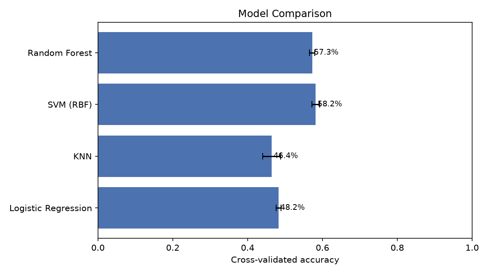
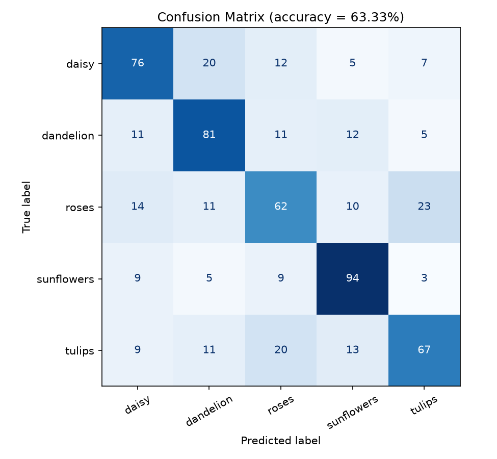
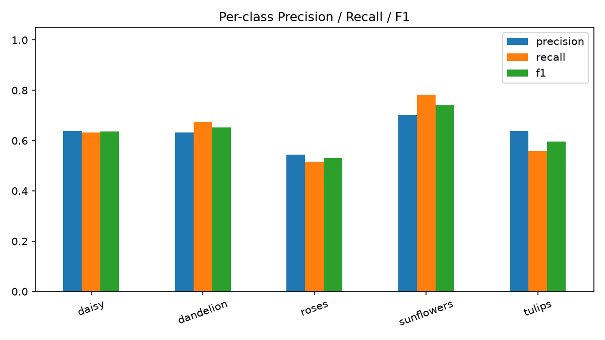
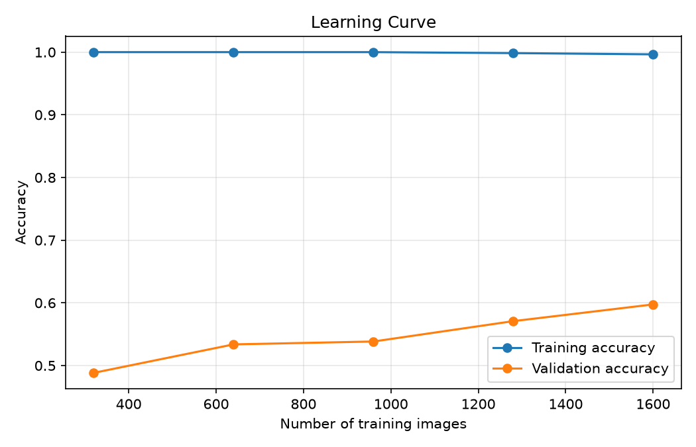

# 🌸 Flower Classification Using Machine Learning

A Python-based Machine Learning project that classifies flower images into different categories using image processing, feature extraction, and supervised learning algorithms.

## 📌 Project Overview

Flower Classification is an image classification project that identifies the category of a flower from its image.

This project extracts visual features from flower images, trains multiple machine learning models, compares their performance, and evaluates the selected model using standard classification metrics.

**Project Type:** Machine Learning / Image Classification  
**Language:** Python  
**Dataset:** Flower Images  
**Models:** Logistic Regression, K-Nearest Neighbors, Support Vector Machine, Random Forest

## 🎯 Objectives

- Classify flower images into different categories.
- Extract useful colour, edge, and image features.
- Train and compare multiple machine learning algorithms.
- Evaluate performance using accuracy, precision, recall, and F1-score.
- Visualize model performance using graphs.
- Save the trained model for future predictions.

## 🛠️ Technologies and Libraries

| Technology | Purpose |
|---|---|
| Python | Main programming language |
| NumPy | Numerical calculations and array operations |
| Pandas | Organizing and handling tabular results |
| Matplotlib | Creating graphs and visualizations |
| Scikit-learn | Training and evaluating machine learning models |
| Pillow (PIL) | Loading, resizing, and processing images |
| Joblib | Saving and loading the trained model |

## 🌼 Flower Categories

The real flower dataset contains five categories:

- Daisy
- Dandelion
- Rose
- Sunflower
- Tulip

The project also includes a synthetic demonstration dataset with Daisy, Lavender, Rose, Sunflower, and Tulip folders. These generated images are used to test the pipeline and are not real flower photographs.

## 📂 Project Structure

```text
flower-classification-ml/
│
├── flower_image_classification.py
├── download_dataset.py
├── requirements.txt
├── README.md
│
├── data/
│   └── demo_flowers/
│
└── outputs/
    ├── 03_model_comparison.png
    ├── 04_confusion_matrix.png
    ├── 05_per_class_scores.png
    ├── 07_learning_curve.png
    ├── results.txt
    └── flower_model.joblib
```

*Note: The output files are generated when the project runs. The real dataset is downloaded separately.*

## ⚙️ Project Workflow

### 1. Dataset Collection

The project loads flower images from folders organized by category. The included downloader retrieves the real flower dataset.

### 2. Image Preprocessing

Images are loaded and resized to 64 × 64 pixels to standardize their dimensions.

### 3. Feature Extraction

The project converts images into numerical features that machine learning algorithms can understand.

It extracts:

- HSV colour histogram features
- Edge and shape histogram features
- Resized image thumbnail features

These features are combined into a vector of 960 numerical values per image.

### 4. Model Training

Four supervised machine learning algorithms are compared:

- **Logistic Regression:** Learns relationships between image features and flower classes.
- **K-Nearest Neighbors (KNN):** Predicts a flower class using similar training examples.
- **Support Vector Machine (SVM):** Separates categories using learned decision boundaries.
- **Random Forest:** Combines multiple decision trees to make predictions.

The project uses three-fold cross-validation to compare the models and GridSearchCV to tune the SVM.

### 5. Model Evaluation

The selected model is evaluated on a held-out test dataset. Performance is measured using accuracy, precision, recall, F1-score, and a confusion matrix.

### 6. Model Saving

The trained model and its class names are saved using Joblib in `outputs/flower_model.joblib`.

### 7. Flower Prediction

After training, the saved model can predict the category of a new flower image.

## 📊 Model Outputs and Visualizations

The following four graphs are the main visualizations generated by this project.

### 1. Model Comparison

**File:** `outputs/03_model_comparison.png`



This graph compares the cross-validation performance of Logistic Regression, KNN, SVM, and Random Forest.

**Interpretation:**
- Higher accuracy indicates better average classification performance during cross-validation.
- Comparing models helps identify promising algorithms.
- The final test-set evaluation provides a separate measure of generalization.

### 2. Confusion Matrix

**File:** `outputs/04_confusion_matrix.png`



The confusion matrix compares the actual flower categories with the categories predicted by the model.

**Interpretation:**
- The main diagonal represents correct predictions.
- Values outside the diagonal represent incorrect predictions.
- It helps identify which flower categories the model confuses.

### 3. Precision, Recall and F1-Score

**File:** `outputs/05_per_class_scores.png`



This graph compares three important evaluation metrics for each flower category.

- **Precision:** How many predictions for a category were correct.
- **Recall:** How many actual images of a category were correctly identified.
- **F1-score:** The harmonic mean of precision and recall.

Values closer to 1.0 generally indicate better performance.

### 4. Learning Curve

**File:** `outputs/07_learning_curve.png`



The learning curve shows how training and validation performance change as the amount of training data increases.

**Interpretation:**
- A large gap between training and validation performance may indicate overfitting.
- Low performance on both curves may indicate underfitting.
- Improving validation performance as more data is used may suggest that additional training data could help.

## 📈 Evaluation Metrics

| Metric | Explanation |
|---|---|
| Accuracy | Percentage of test images classified correctly |
| Precision | Reliability of positive predictions for a class |
| Recall | Percentage of actual class images correctly identified |
| F1-score | Balance between precision and recall |
| Confusion Matrix | Shows correct and incorrect predictions |
| Cross-validation Accuracy | Average performance across validation folds |

### Important Note About Results

The synthetic demonstration dataset is designed to test the program workflow. Results from synthetic images must not be treated as evidence of real-world flower recognition accuracy.

For a meaningful project evaluation, download the real flower dataset, train the model, and report the actual results recorded in `outputs/results.txt`.

## 💻 Installation and Setup

### Prerequisites

- Python 3.9 or newer
- Git
- Internet connection to download the real dataset

### Step 1: Clone the Repository

```bash
git clone https://github.com/Vedant1427/flower-classification-ml.git
cd flower-classification-ml
```

### Step 2: Create a Virtual Environment

```bash
python -m venv .venv
```

Activate it on Windows:

```bash
.venv\Scripts\activate
```

### Step 3: Install Dependencies

```bash
python -m pip install -r requirements.txt
```

## ▶️ Running the Project

### Option 1: Run with Demonstration Images

```bash
python flower_image_classification.py data/demo_flowers
```

This runs the pipeline using the included synthetic images and generates the evaluation outputs.

### Option 2: Run with the Real Dataset

Download the dataset:

```bash
python download_dataset.py
```

Train and evaluate the model:

```bash
python flower_image_classification.py data/flower_photos --max-images 3000
```

The program trains and compares the models, evaluates the selected model, and generates the output graphs.

### Option 3: Predict a New Flower Image

After training, use:

```bash
python flower_image_classification.py --predict "path/to/flower.jpg"
```

Replace the example path with the location of your image.

## ⚠️ Limitations

- The project uses handcrafted features rather than a deep learning architecture.
- Lighting, backgrounds, image quality, and flower similarities can affect predictions.
- Synthetic demonstration results do not establish real-world performance.
- Model performance can vary depending on the dataset and training configuration.

## 🚀 Future Improvements

- Implement a Convolutional Neural Network (CNN).
- Explore transfer learning using pretrained image classification models.
- Develop a web application for uploading flower images.
- Display prediction confidence and alternative categories.
- Expand the dataset and evaluate performance on unseen real-world photographs.

## 👨‍💻 Author

**Vedant Gothwad**

GitHub: [@Vedant1427](https://github.com/Vedant1427)

**Project Repository:** [Flower Classification Using Machine Learning](https://github.com/Vedant1427/flower-classification-ml)

## 📄 License

No license has been specified yet. Add an appropriate open-source license if you want others to reuse, modify, or distribute this project.

---

*Built with Python and Machine Learning for image classification and practical learning.*
